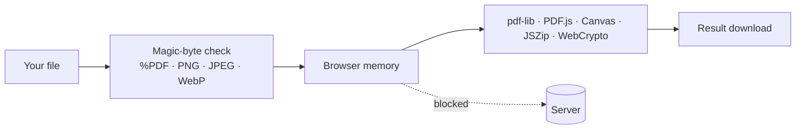

<div align="center">

# 🔒 NoUploadPDF

### Your PDFs never leave your device.

**Merge, sign, redact and compress PDFs without uploading them — plus a WebRTC peer-to-peer phone camera scanner that feeds pages straight into the Studio.**

No signup · Processed in your browser · Works offline (PWA) · MIT licensed

[Verify the privacy claim](#-dont-trust-us-verify-it) · [Report a bug](../../issues) · [Request a tool](../../issues/new)


*8-second walkthrough: real-time live preview, WebRTC phone scanning & target-size compression with 0 network uploads.*

</div>

---

## Why this exists

Most online PDF tools ask you to upload contracts, agreements and private documents to a server you know nothing about, then cap you at "2 free tasks per day."

NoUploadPDF does the work **inside your browser tab**. The file is read into memory, processed with JavaScript/WebAssembly, and handed back to you. Close the tab and it is gone.

## ✨ What you get

| Category | Tools |
|---|---|
| **Organize (11)** | Merge, Split, Extract pages, Rotate, Reorder & delete, Alternate & mix (duplex), Split by text, Split by bookmarks, Split in half, Split by size, Pages per sheet (N-up) |
| **Convert (6)** | Phone camera scan (WebRTC P2P + Direct Camera Capture), Images → PDF, PDF → images (ZIP), PDF → Word (`.docx`), PDF → Markdown (`.md`), PDF → ZIP |
| **Edit (6)** | Sign, Redact (rasterized burn-in + metadata wipe), Watermark, Page & Bates numbers, Crop margins, Flip & mirror |
| **Optimize (5)** | Target-Size Compress (`100 KB` / `200 KB` / `1 MB`), OCR text index (Tesseract WASM + text layer), Protect & unlock (AES-256-GCM), Scrub metadata, Compare & batch |

**Studio workspace.** A 3-pane editor (files · live page thumbnail preview · settings) with multi-step **Undo (`⌘Z`)** and keyboard shortcuts (`?`). Edits carry from one tool to the next, so you can merge → compress → sign without re-selecting files.

**Phone → Studio scanner (WebRTC Peer-to-Peer + Direct Capture).** Scan a QR code with an iPhone or Android phone to stream pages directly phone-to-browser over an encrypted WebRTC `RTCDataChannel` (0 bytes stored on any server), or use the built-in `<input type="file" capture="environment">` camera button on any connection.

**Verifiable network log.** Instead of a static badge, NoUploadPDF wraps `fetch`, `XMLHttpRequest`, and `PerformanceObserver` to show a real, live request log (`Requests carrying your data: 0 · view log`).

## 🔍 Don't trust us. Verify it.

1. Open your browser DevTools → **Network** tab (or click **Requests carrying your data: 0 · view log** in the header).
2. Drop a PDF and run any tool.
3. Watch the list: you will only see static assets, never your file.
4. Turn on **Airplane mode** and run a tool again. It still works.

You can also read the code: every tool lives in `app/javascript/` and `app/views/pages/home.html.erb`.

## 🧱 How it works



- **Rails 8 + Hotwire (Stimulus)** serves the app shell and WebRTC signaling room only.
- **`pdf-lib`** edits PDFs, **PDF.js** renders and extracts text, **Canvas** handles redaction/rotation/target-size compression, **JSZip** bundles outputs, **WebCrypto** does SHA-256 and AES-256-GCM (PBKDF2-derived keys).
- **`NoUploadGuardMiddleware`** rejects binary/multipart upload bodies and sets `X-Frame-Options: DENY`, `X-Content-Type-Options: nosniff`, `Cross-Origin-Opener-Policy: same-origin`, `Referrer-Policy: no-referrer`.
- Filenames, room codes and metadata fields are sanitized against XSS and path traversal.

## 🚀 Run it locally

```bash
git clone git@github.com:avartan007/NoUploadPDF.git
cd NoUploadPDF
bundle install
bin/rails server -p 3005
```

### Phone scanner

Open `/scanner` on your computer, then scan the QR code with your phone:
- **Public HTTPS site:** Uses your site's HTTPS origin and establishes a direct **WebRTC peer-to-peer `RTCDataChannel`** between phone and desktop browser.
- **Local Wi-Fi (`localhost`):** Uses your LAN IP so a phone on the same Wi-Fi can connect, and provides a direct `<input type="file" accept="image/*" capture="environment">` fallback button that works on any connection.

## 🛡️ Security model & honest limitations

**What we guarantee:** the app server is configured to refuse file uploads, and no tool sends your document anywhere.

**What to know:**
- *Redact* rasterizes the redacted pages, so those pages lose selectable text by design. That is what makes the redaction irreversible.
- Very large PDFs (300 MB+) are limited by your device's memory, especially on mobile Safari.
- The phone scanner sends photos from your phone to the computer over WebRTC peer-to-peer or your local network.
- Browser extensions can see page content. Use a clean profile for highly sensitive files.
- Local OCR and extractive summary helpers run locally and are less capable than cloud AI services or hardware-backed legal e-signature platforms.

Found a vulnerability? Please read [SECURITY.md](SECURITY.md) and report it privately.

## 🗺️ Roadmap

- [x] Installable PWA with full offline cache
- [x] Target-size compression ("under 100 KB / 200 KB / 1 MB" for government and job portals)
- [x] Local auto-redact pattern scanner for emails, phone numbers and common ID formats
- [x] Fill & sign form fields
- [x] Peer-to-peer (WebRTC `RTCDataChannel`) phone transfer for the hosted site + direct `<input type="file" capture>` fallback
- [x] Shareable "pipeline recipes" (the steps, never the files)
- [x] Multi-step Undo (`⌘Z`) and keyboard shortcuts overlay (`?`)
Vote on features or suggest new ones in [Issues](../../issues).

## 🤝 Contributing

PRs are welcome. Good first issues are labeled [`good first issue`](../../labels/good%20first%20issue). Please:

1. Open an issue for larger changes first.
2. Keep every feature **fully client-side**. Anything that transmits a user's file will not be merged.
3. Add or update tests for tool logic.

## 📄 License

[MIT](LICENSE) © 2026 @avartan007

## ⭐ If this saved you from uploading a file

Give the repo a star. It helps other privacy-minded people find it, and it genuinely makes my day.
