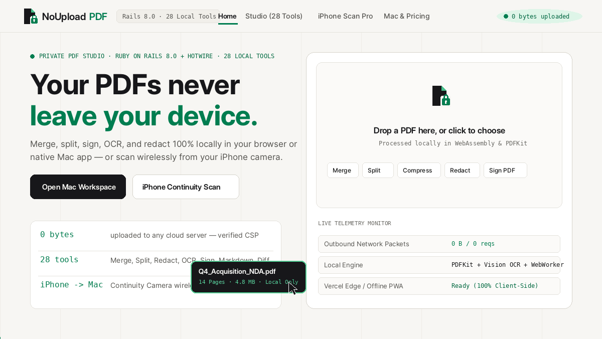
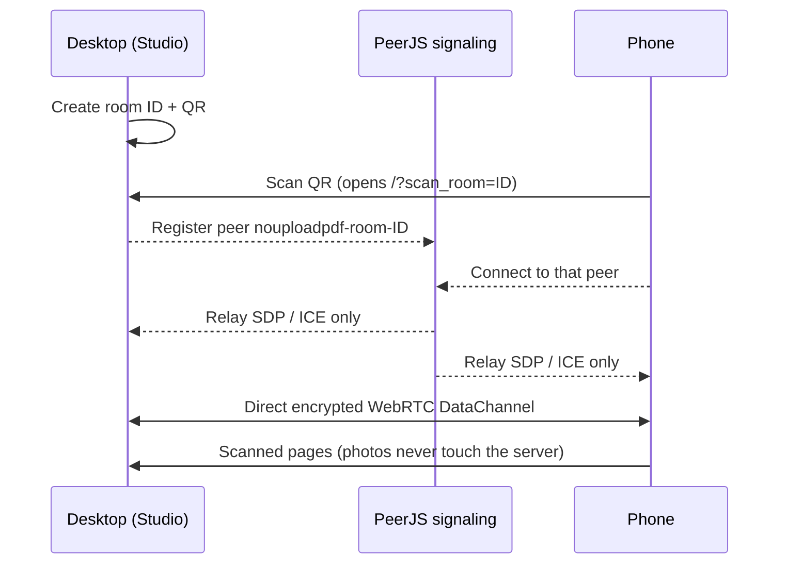

<div align="center">


# NoUploadPDF

### Your PDFs never leave your device.

**28 private PDF tools that run entirely in your browser, plus a phone-camera scanner that sends pages to your computer peer-to-peer.**

No signup · No uploads · Works offline · MIT

[**Open the app**](https://nouploadpdf.vercel.app/) · [Verify the claim](#-dont-trust-us-verify-it) · [Report a bug](https://github.com/avartan007/NoUploadPDF/issues) · [Request a tool](https://github.com/avartan007/NoUploadPDF/issues/new)

<!-- 10-second GIF: drop a PDF → compress to 200 KB → DevTools Network tab showing no requests -->



</div>

---

## Why this exists

I needed to compress and redact personal application PDFs to fit strict 200 KB portal limits, without handing private pages to a random cloud server. Most online PDF tools upload your file, store a copy, and cap you at a couple of free tasks a day.

NoUploadPDF does the work **inside your browser tab**. The file is read into memory, processed with JavaScript and WebAssembly, and handed back to you.

## ✨ Features

| Group | Tools |
|---|---|
| **Organize (11)** | Merge, Split, Extract pages, Rotate, Reorder & delete, Alternate & mix, Split by text, Split by bookmarks, Split in half, Split by size, Pages per sheet |
| **Convert (6)** | Phone camera scan, Images → PDF, PDF → images (ZIP), PDF → Word, PDF → Markdown, PDF → ZIP |
| **Edit (6)** | Sign, Redact (216 DPI burn-in), Watermark, Page & Bates numbers, Crop margins, Flip & mirror |
| **Optimize (5)** | Compress (incl. target size: 100 KB / 200 KB presets), OCR text index, Protect & unlock (AES-256-GCM), Scrub metadata, Compare & batch |

**Also:** 3-pane Studio with live page preview, tool chaining (edits carry to the next tool), undo, command palette (`⌘K`), keyboard shortcuts (`?`), installable PWA, shareable "proof" card, one-click workflow presets.

## 🔍 Don't trust us. Verify it.

1. Open DevTools → **Network**.
2. Drop a PDF and run any tool.
3. You will see static assets only. Your file is never in a request.
4. Switch to **Airplane mode** and run a tool again. It still works.

The app also shows a live outgoing-request monitor (wraps `fetch`, `XMLHttpRequest`, `sendBeacon`, and observes resource loads). It is a convenience, so use DevTools as the source of truth.

## 📱 Phone → Studio scanner (how pairing works)



- **Photos travel peer-to-peer** over an encrypted WebRTC DataChannel.
- **A signaling relay is used for the handshake.** By default this is the public PeerJS cloud, which sees the room ID, your IP address, and connection negotiation data (SDP/ICE), never your photos. You can self-host a PeerJS server and change the host in the config.
- STUN/TURN servers used for NAT traversal can see IP addresses. A TURN relay only carries encrypted traffic.
- **Fallbacks:** `BroadcastChannel` for testing in two tabs on one device, and a native camera/file input if WebRTC is blocked.
- Pair only with your own devices. Close the scanner when done.

## 🛡️ Security model & honest limitations

- **No upload endpoint.** The site is static files. There is no server route that accepts a document.
- **Local storage.** Working files are kept in memory and in your browser's IndexedDB so edits survive a refresh. **Clear All** removes them. You can inspect this in DevTools → Application → IndexedDB.
- **Redaction** rasterizes redacted pages at 216 DPI, so text under black boxes cannot be extracted. Review every box (auto-detect can miss things) and run *Scrub metadata*.
- **Large files** are limited by your device's memory (roughly 300 MB on desktop, 80 MB on mobile Safari).
- **OCR** is local WASM and works best on clean printed text.
- **Signatures** are visual stamps, not certificate-based e-signatures.
- Browser extensions can read page content. Use a clean profile for very sensitive files.

Found a vulnerability? See [SECURITY.md](SECURITY.md) and report privately.

## 🚀 Run locally (Next.js + React + Node.js/Express)

1. Open the `NoUploadPDF` repository directory in your terminal.
2. Sync React components and start the Node.js + Express development server (with HTTP 403 Upload Guard & CSP headers):
   - `npm run dev` (starts `http://localhost:3000`)
   - `npm test` (runs the automated Node.js test suite)

*(Note: A complete archive of the legacy Ruby on Rails prototype is preserved in `ror-backup-nouploadpdf.zip` in the project root.)*

## 🗂️ Project structure (Next.js + React + Node.js/Express)

```text
.
├── package.json                       # Next.js, React, Express, Three.js, GSAP, PDF-Lib
├── next.config.mjs                    # Next.js configuration & security headers
├── server/
│   ├── index.js                       # Node.js + Express server with SPA routing & CSP headers
│   └── middleware/
│       └── noUploadGuard.js           # Express middleware rejecting file uploads with HTTP 403
├── src/
│   ├── pages/                         # Next.js Routes (/, /studio, /tools, /tools/[slug], /scanner, /compare, /about)
│   ├── components/                    # Modular Reusable React Components
│   │   ├── AppShell.jsx               # Master React shell & router coordinator
│   │   ├── Navbar.jsx                 # Sticky glass header, mobile sheet & WebGL2 ink-bleed toggle
│   │   ├── SvgFilters.jsx             # SVG feTurbulence ink-bleed & liquid ripple filters
│   │   ├── HeroThreeTornado.jsx       # Three.js + GSAP 3D tornado -> laptop -> ink-bleed hero
│   │   ├── InteractivePreview.jsx     # Interactive live tool preview
│   │   ├── PeaceOfMindSection.jsx     # 3-pillar privacy proof & live network monitor
│   │   ├── ToolsCatalog.jsx           # 28-tool filterable catalog & Smart Document Helpers
│   │   ├── ComparisonSection.jsx      # Side-by-side comparison table & FAQ
│   │   ├── StudioWorkspace.jsx        # 3-pane PDF Studio workspace
│   │   ├── PhoneScanner.jsx           # WebRTC P2P QR phone camera scanner + SAS gate
│   │   ├── AboutSection.jsx           # About & security architecture view
│   │   └── Footer.jsx                 # Verifiable build footer & guide links
│   ├── data/
│   │   └── toolCatalog.js             # Canonical 28-tool definitions, slugs & CSP headers
│   ├── engine/
│   │   └── clientEngine.js            # Client-side PDF-Lib, PDF.js, Three.js, GSAP & WebGL2 engine
│   └── styles/
│       └── globals.css                # Paper-and-ink design system + mobile-responsive layout
├── scripts/
│   └── sync-static.mjs                # Static HTML/CSS bundle generator from React components
├── tests/
│   └── zeroUploadGuard.test.mjs       # Automated Node.js test suite
├── public/                            # Static assets, Service Worker (sw.js v5) & pre-rendered routes
├── ror-backup-nouploadpdf.zip         # Archived backup of the legacy Ruby on Rails codebase
└── vercel.json                        # Vercel cleanUrls, rewrites & strict security headers
```

## 🧰 Built with

[Next.js](https://nextjs.org/) · [React](https://react.dev/) · [Node.js](https://nodejs.org/) · [Express](https://expressjs.com/) · [Three.js](https://threejs.org/) · [GSAP](https://gsap.com/) · [WebGL2](https://www.khronos.org/webgl/) · [pdf-lib](https://pdf-lib.js.org/) · [PDF.js](https://mozilla.github.io/pdf.js/) · [JSZip](https://stuk.github.io/jszip/) · [PeerJS](https://peerjs.com/) · [qrcode-generator](https://github.com/kazuhikoarase/qrcode-generator) · WebCrypto · Canvas · IndexedDB · Service Worker · Vercel

## 🗺️ Roadmap

- [ ] Self-hostable signaling server option and longer pairing codes with on-screen approval
- [ ] Local AI summary and chat (WebGPU/WASM)
- [ ] Fill & sign form fields
- [ ] Reproducible build + build-hash footer
- [ ] Hindi and Japanese UI

## 🤝 Contributing

PRs are welcome. Keep every feature **fully client-side**: anything that sends a user's document anywhere won't be merged. See [CONTRIBUTING.md](CONTRIBUTING.md) and the [`good first issue`](https://github.com/avartan007/NoUploadPDF/labels/good%20first%20issue) label.

## 📄 License

MIT © 2026 [@avartan007](https://github.com/avartan007)

## ⭐ If this saved you from uploading a file

Star the repo so other privacy-minded people can find it.
